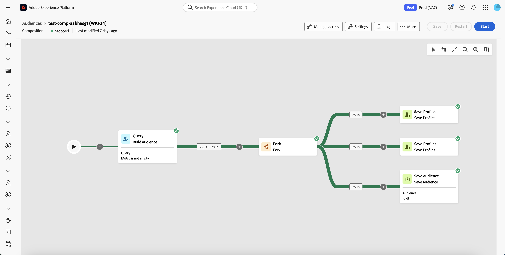
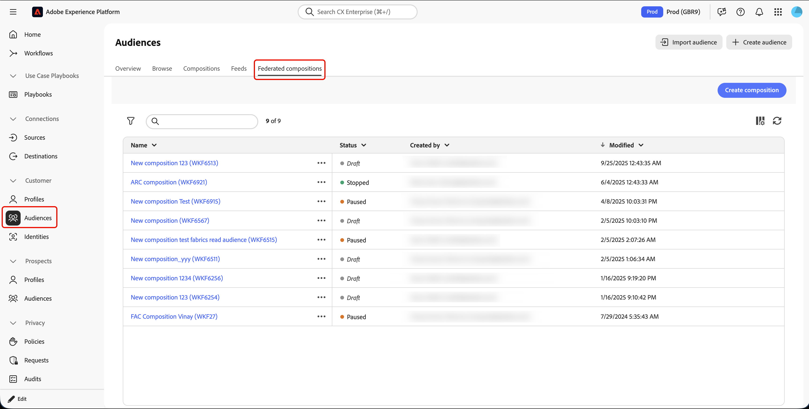
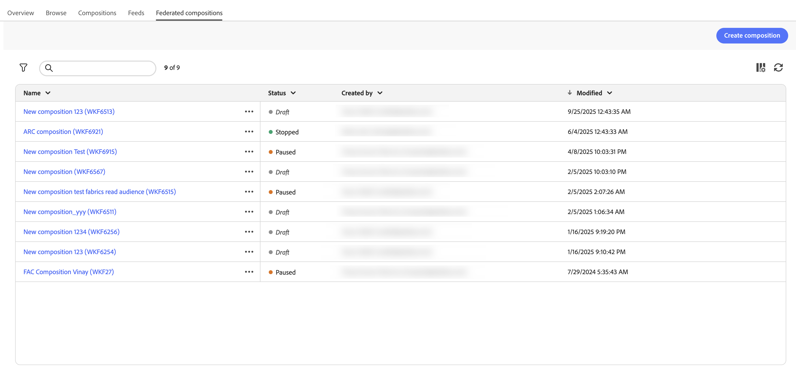
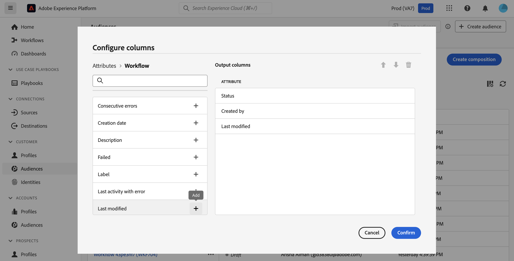
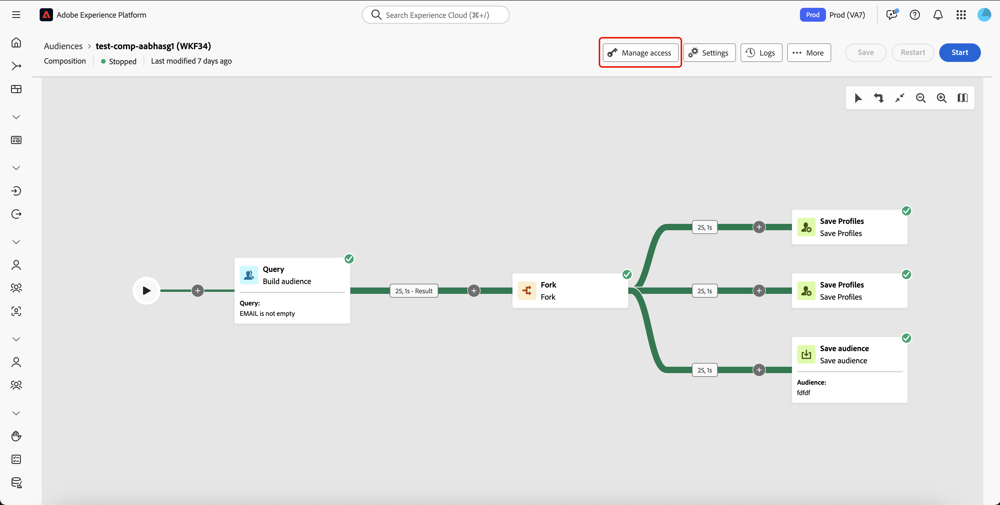
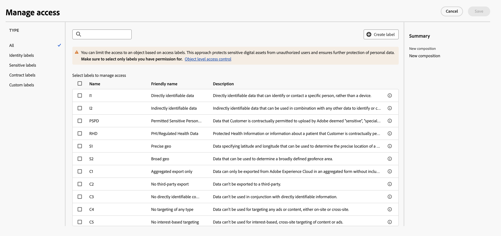

# Resumen de composiciones

>[!AVAILABILITY]
>
>Para acceder a las composiciones, necesita uno de los siguientes permisos:
>
>-**Administrar composiciones federadas**
>-**Ver composiciones federadas**
>
>Para obtener más información sobre los permisos necesarios, consulte la [guía de control de acceso](/help/governance-privacy-security/access-control.md).

La composición de público federado le permite crear composiciones, donde puede aprovechar diversas actividades en un lienzo visual para crear públicos. Después de crear la composición, los públicos resultantes se guardan en Adobe Experience Platform y se pueden aprovechar en destinos de Experience Platform y Adobe Journey Optimizer para dirigirse a los clientes.

{zoomable="yes"}{width="70%"}

## Componentes de composición {#components}

Una composición dentro de Composición de audiencia federada consta de las siguientes partes:

- **[!UICONTROL Actividades]**: una actividad es una tarea que se va a realizar y se representan dentro de la composición mediante iconos.
- **[!UICONTROL Transiciones]**: las transiciones vinculan una actividad de origen a una actividad de destino y definen su secuencia. La información contenida en las transiciones se almacena en una tabla de trabajo. Cada composición utiliza varias tablas de trabajo. Los datos transmitidos en estas tablas pueden utilizarse en todo el ciclo de vida de la composición.

## Acceder a composiciones y administrarlas {#access}

>[!CONTEXTUALHELP]
>id="dc_composition_list"
>title="Composiciones"
>abstract="En esta pantalla, puede acceder a la lista completa de composiciones, comprobar su estado actual, las fechas de última/siguiente ejecución y crear una nueva composición."

A las composiciones se puede acceder desde el menú **[!UICONTROL Públicos]** de Adobe Experience Platform, en la pestaña **[!UICONTROL Composiciones federadas]** dentro de la sección **[!UICONTROL Clientes]**.

{zoomable="yes"}{width="70%"}

Desde esta pantalla, puede ver información sobre las composiciones y crear nuevas composiciones.

{zoomable="yes"}{width="70%"}

| Campo | Descripción |
| ----- | ----------- |
| **[!UICONTROL Nombre]** | Nombre de la composición. Si selecciona la composición, podrá editarla. Para obtener más información sobre cómo crear y editar composiciones, lea [crear una guía de composición](/help/compositions/create-composition.md). |
| **[!UICONTROL Estado]** | El estado de la composición. Los valores posibles incluyen [!UICONTROL Borrador], [!UICONTROL En curso], [!UICONTROL Detenido], [!UICONTROL En pausa] y [!UICONTROL Erróneo]. <ul><li>**[!UICONTROL Borrador]**: la composición se ha creado y guardado.</li><li>**[!UICONTROL En curso]**: la composición se ha ejecutado y se está ejecutando.</li><li>**[!UICONTROL Detenido]**: la ejecución de la composición se ha completado y se ha detenido.</li><li>**[!UICONTROL En pausa]**: La ejecución de la composición se ha pausado.</li><li>**[!UICONTROL Erróneo]**: La ejecución de la composición ha encontrado un error. Para ver más información sobre el error, abra la composición y acceda a los registros.</li></ul> Para aprender a iniciar o detener una composición, lea la [guía de creación de composición](./create-composition.md#monitor-logs). |
| **[!UICONTROL Creado por]** | El nombre y la dirección de correo electrónico de la persona que creó la composición. |
| **[!UICONTROL Modificado]** | La fecha y la hora en que se actualizó la composición por última vez. |

También puede realizar acciones rápidas en las composiciones seleccionando el botón  junto a su nombre.

| Acción | Descripción |
| ------ | ----------- |
| **[!UICONTROL Duplicado]** | Duplica la composición seleccionada. |
| **[!UICONTROL Eliminar]** | Elimina la composición seleccionada. |
| **[!UICONTROL Agregar al paquete]** | Mueve la composición entre zonas protegidas. Para obtener más información acerca de esta característica, lea la [guía de herramientas para zonas protegidas](https://experienceleague.adobe.com/es/docs/experience-platform/sandbox/ui/sandbox-tooling). |

Para detallar la lista y encontrar fácilmente la composición que está buscando, puede buscar en la lista y filtrar las composiciones por su estado o fechas de último procesamiento.

También puede personalizar la lista añadiendo o quitando columnas. Para ello, seleccione el botón **[!UICONTROL Configurar columnas]** y añada o quite las columnas de salida que desee.

{zoomable="yes"}{width="70%"}

### Aplicación de etiquetas de acceso {#access-labels}

Para aplicar etiquetas de acceso a una composición específica, seleccione la composición, seguida de **[!UICONTROL Administrar acceso]**.

{zoomable="yes"}{width="70%"}

Aparece la ventana emergente **[!UICONTROL Administrar acceso]**. En esta página, puede aplicar las etiquetas de acceso y de gobernanza de datos aplicables a su composición.

{zoomable="yes"}{width="70%"}

| Tipo de etiqueta | Descripción |
| ---------- | ----------- |
| Etiquetas de contrato | Las etiquetas de contrato (etiquetas &quot;C&quot;) se utilizan para clasificar los datos que tienen obligaciones contractuales o que están relacionados con las políticas de gobernanza de datos de su organización. |
| Etiquetas de identidad | Las etiquetas de identidad (etiquetas “I”) se utilizan para clasificar los datos que permiten identificar a una persona específica o ponerse en contacto con ella. |
| Etiquetas confidenciales | Las etiquetas confidenciales (etiquetas &quot;S&quot;) se utilizan para clasificar la información que usted o su organización consideran confidenciales. |
| Etiquetas del ecosistema de socios | Las etiquetas del ecosistema de socios se utilizan para clasificar los datos de fuentes externas a su organización. |

Para obtener más información sobre las etiquetas de acceso y de gobernanza de datos, lea el [glosario de etiquetas de uso de datos](https://experienceleague.adobe.com/es/docs/experience-platform/data-governance/labels/reference).

## Crear {#create}

Puede crear una composición para Adobe Experience Platform mediante Composición de audiencias. Para obtener más información, lea [crear una guía de composición](./create-composition.md).

## Próximos pasos

Después de leer esta guía, ha aprendido a acceder, administrar y crear etiquetas de acceso para sus composiciones. Para obtener más información sobre cómo trabajar con públicos en general, lea la [guía de públicos](../start/audiences.md).
