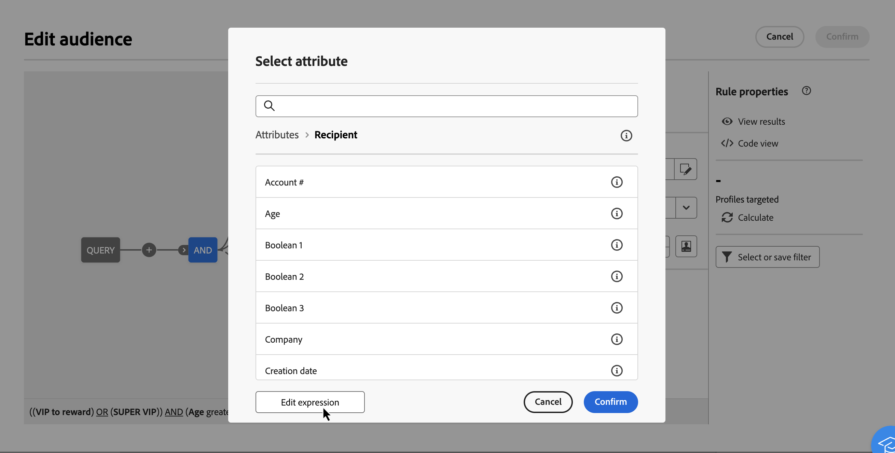
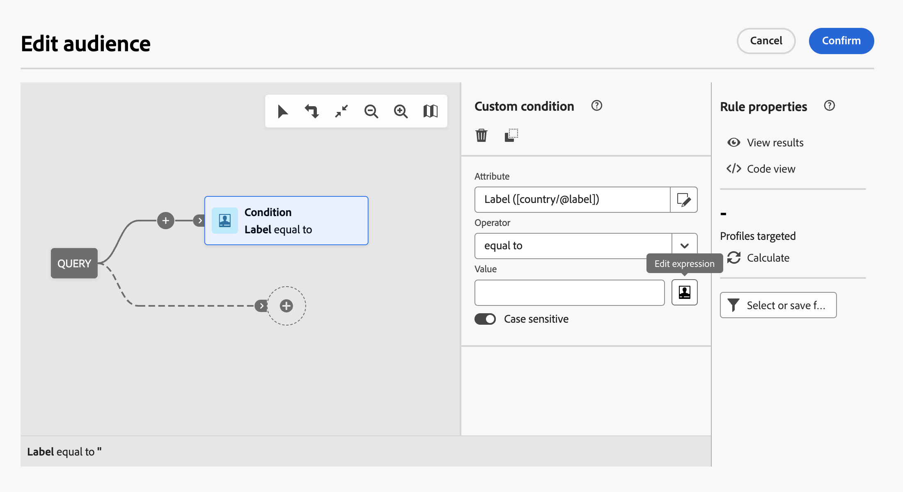
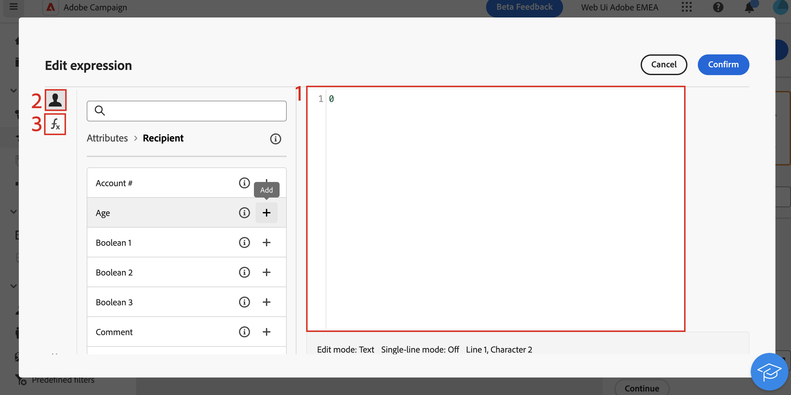
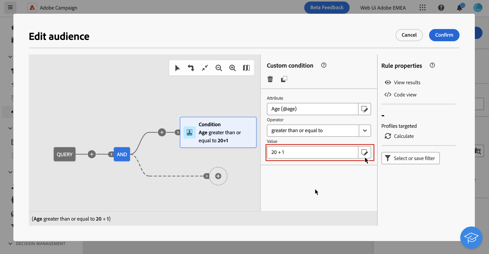

# Resumen del editor de expresiones {#expression}

Editar una expresión implica introducir manualmente las condiciones para formar una regla. Este modo le permite utilizar funciones avanzadas, que le permiten manipular los valores utilizados para llevar a cabo consultas específicas, como la manipulación de fechas, cadenas, campos numéricos, ordenación, etc.

## Trabajo con el editor de expresiones {#edit}

El editor de expresiones está disponible en el botón del modelador de consultas **[!UICONTROL Editar expresión]**, disponible para los campos **[!UICONTROL Atributo]** y **[!UICONTROL Valor]** al configurar una condición personalizada.

| Acceso desde el campo **[!UICONTROL Atributo]** | Acceso desde el campo **[!UICONTROL Valor]** |
|  ---  |  ---  |
| {zoomable="yes"}{width="200" align="center" zoomable="yes"} | {zoomable="yes"}{width="200" align="center" zoomable="yes"} |

El editor de expresiones proporciona lo siguiente:

* Un **campo de entrada (1)** en el que se define la expresión.
* La lista de **campos (2)** disponibles que se pueden usar en la expresión y que corresponden al esquema, también conocido como dimensión de segmentación, de la consulta.
* **Funciones de ayuda (3)**, ordenadas por categoría.

Edite la expresión introduciendo una expresión directamente en el campo de entrada. Para añadir un campo o una función de ayuda, coloque el cursor en la expresión donde desee añadirla y seleccione el botón +.

{zoomable="yes"}

Cuando la expresión esté lista, seleccione **[!UICONTROL Confirmar]**. La expresión se muestra en el campo seleccionado. Para editarlo, abra el editor de expresiones y realice los cambios deseados.

El ejemplo siguiente muestra una expresión configurada para el campo **[!UICONTROL Value]**. Para editarlo, debe abrir el editor de expresiones con el botón **[!UICONTROL Editar expresión]**.

{zoomable="yes"}

## Funciones de ayuda

La herramienta de edición de consultas le permite utilizar funciones avanzadas para llevar a cabo filtros complejos según los resultados deseados y los tipos de datos manipulados. Estas son las funciones disponibles:

### Fecha

Las funciones de fecha se utilizan para manipular los valores de fecha y hora.

>[!BEGINTABS]

>[!TAB Google BigQuery]

| Nombre | Descripción | Sintaxis | Ejemplo |
| ---- | ----------- | ------ | ------- |
| **AddYears** | Agrega el número de años especificado a la fecha y hora proporcionadas. | AddYears(&lt;DATETIME>, &lt;NUMBER>) | AddYears(&quot;2019-12-25 15:30:00&quot;, 3) |
| **AddMonths** | Agrega el número de meses especificado a la fecha y hora proporcionadas. | AddMonths(&lt;DATETIME>, &lt;NUMBER>) | AddMonths(&quot;2019-12-25 15:30:00&quot;, 6) |
| **AddDays** | Agrega el número de días especificado a la fecha y hora proporcionadas. | AddDays(&lt;DATETIME>, &lt;NUMBER>) | AddDays(&quot;2019-12-25 15:30:00&quot;, 10) |
| **AddHours** | Agrega el número de horas especificado a la fecha y hora proporcionadas. | AddHours(&lt;DATETIME>, &lt;NUMBER>) | AddHours(&quot;2019-12-25 15:30:00&quot;, 3) |
| **AddMinutes** | Agrega el número de minutos especificado a la fecha y hora proporcionadas. | AddMinutes(&lt;DATETIME>, &lt;NUMBER>) | AddMinutes(&quot;2019-12-25 15:30:00&quot;, 32) |
| **AddSeconds** | Agrega el número de segundos especificado a la fecha y hora proporcionadas. | AddSeconds(&lt;DATETIME>, &lt;NUMBER>) | AddSeconds(&quot;2019-12-25 15:30:00&quot;, 37) |
| **SubYears** | Resta el número de años especificado a la fecha y hora proporcionadas. | SubYears(&lt;DATETIME>, &lt;NUMBER>) | SubYears(&quot;2019-12-25 15:30:00&quot;, 3) |
| **SubMonths** | Resta el número de meses especificado a la fecha y hora proporcionadas. | SubMonths(&lt;DATETIME>, &lt;NUMBER>) | SubMonths(&quot;2019-12-25 15:30:00&quot;, 6) |
| **SubDays** | Resta el número de días especificado a la fecha y hora proporcionadas. | SubDays(&lt;DATETIME>, &lt;NUMBER>) | SubDays(&quot;2019-12-25 15:30:00&quot;, 10) |
| **SubHours** | Resta el número de horas especificado a la fecha y hora proporcionadas. | SubHours(&lt;DATETIME>, &lt;NUMBER>) | SubHours(&quot;2019-12-25 15:30:00&quot;, 3) |
| **SubMinutes** | Resta el número de minutos especificado a la fecha y hora proporcionadas. | SubMinutes(&lt;DATETIME>, &lt;NUMBER>) | SubMinutes(&quot;2019-12-25 15:30:00&quot;, 32) |
| **SubSeconds** | Resta el número de segundos especificado a la fecha y hora proporcionadas. | SubSeconds(&lt;DATETIME>, &lt;NUMBER>) | SubSeconds(&quot;2019-12-25 15:30:00&quot;, 37) |
| **Year** | Extrae el año del objeto datetime dado. | Year(&lt;DATETIME>) | Year(&quot;2019-12-15 15:30:00&quot;) |
| **Month** | Extrae el mes del objeto datetime dado. | Month(&lt;DATETIME>) | Month(&quot;2019-12-15 15:30:00&quot;) |
| **Day** | Extrae el día del objeto datetime determinado. | Day(&lt;DATETIME>) | Day(&quot;2019-12-15 15:30:00&quot;) |
| **DayOfYear** | Extrae el día del año del objeto de fecha y hora dado. Por ejemplo, si la fecha y hora proporcionadas es el 2 de febrero, devolvería 33. | DayOfYear(&lt;DATETIME>) | DayOfYear(&quot;2019-12-15 15:30:00&quot;) |
| **WeekDay** | Extrae el día de la semana del objeto datetime determinado, como un número del 0 al 6, donde 0 representa el domingo. | Year(&lt;DATETIME>) | Year(&quot;2019-12-15 15:30:00&quot;) |
| **Hour** | Extrae el valor de hora del objeto datetime dado. | Year(&lt;DATETIME>) | Year(&quot;2019-12-15 15:30:00&quot;) |
| **Minute** | Extrae el valor de minuto del objeto datetime dado. | Year(&lt;DATETIME>) | Year(&quot;2019-12-15 15:30:00&quot;) |
| **Second** | Extrae el segundo valor del objeto datetime dado. | Year(&lt;DATETIME>) | Year(&quot;2019-12-15 15:30:00&quot;) |
| **YearsDiff** | Encuentra la diferencia entre las horas de datos dadas, con una granularidad de años. | YearsDiff(&lt;DATETIME>, &lt;DATETIME>) | YearsDiff(&quot;2019-12-25 15:30:00&quot;, &quot;2018-10-14 18:35:27&quot;) |
| **MonthsDiff** | Encuentra la diferencia entre las fechas y horas determinadas, con una granularidad de meses. | MonthsDiff(&lt;DATETIME>, &lt;DATETIME>) | MonthsDiff(&quot;2019-12-25 15:30:00&quot;, &quot;2018-10-14 18:35:27&quot;) |
| **DaysDiff** | Busca la diferencia entre las horas de fecha especificadas, con una granularidad de días. | DaysDiff(&lt;DATETIME>, &lt;DATETIME>) | DaysDiff(&quot;2019-12-25 15:30:00&quot;, &quot;2018-10-14 18:35:27&quot;) |
| **HoursDiff** | Busca la diferencia entre las horas de la fecha y hora especificadas, con una granularidad de horas. | HoursDiff(&lt;DATETIME>, &lt;DATETIME>) | HoursDiff(&quot;2019-12-25 15:30:00&quot;, &quot;2018-10-14 18:35:27&quot;) |
| **MinutesDiff** | Busca la diferencia entre las horas de datos indicadas, con una granularidad de minutos. | MinutesDiff(&lt;DATETIME>, &lt;DATETIME>) | MinutesDiff(&quot;2019-12-25 15:30:00&quot;, &quot;2018-10-14 18:35:27&quot;) |
| **SecondsDiff** | Busca la diferencia entre las horas de datos indicadas, con una granularidad de segundos. | SecondsDiff(&lt;DATETIME>, &lt;DATETIME>) | SecondsDiff(&quot;2019-12-25 15:30:00&quot;, &quot;2018-10-14 18:35:27&quot;) |
| **YearsOld** | Encuentra la diferencia entre la fecha y hora dadas y el presente, con una granularidad de años. | YearsOld(&lt;DATETIME>) | YearsOld(&quot;2019-12-25 15:30:00&quot;) |
| **MonthsOld** | Busca la diferencia entre la fecha y hora dadas y la fecha actual, con una granularidad de meses. | MonthsOld(&lt;DATETIME>) | MonthsOld(&quot;2019-12-25 15:30:00&quot;) |
| **DaysOld** | Busca la diferencia entre la fecha y hora dadas y la fecha actual, con una granularidad de días. | DaysOld(&lt;DATETIME>) | DaysOld(&quot;2019-12-25 15:30:00&quot;) |
| **GetDate** | Obtener la fecha actual del servidor. | GetDate() | GetDate() |
| **DateOnly** | Trunca la fecha y hora a sólo el año, el mes y el día. | DateOnly(&lt;DATETIME>) | DateOnly(&quot;2019-12-25 15:30:00&quot;) |
| **ToDate** | Convierte el campo en un campo de fecha. | ToDate(&lt;DATETIME>) | ToDate(&quot;2019-12-25 15:30:00&quot;) |
| **ToDateTime** | Convierte el campo en un campo de fecha y hora. | ToDateTime(&lt;DATE>) | ToDateTime(&quot;2019-12-25 15:30:00&quot;) |
| **ToTimestamp** | Convierte el campo en un campo de marca de tiempo. | ToTimestamp(&lt;DATETIME>) | ToTimestamp(&quot;2019-12-25 15:30:00&quot;) |
| **Oldest** | Devuelve la fecha más antigua entre las dos proporcionadas. | Oldest(&lt;DATETIME>, &lt;DATETIME>) | Oldest(&quot;2015-02-13 11:59:59&quot;, &quot;2016-04-13 19:28:14&quot;) |
| **TruncDate** | Trunca la fecha y hora a la unidad más cercana, según el valor numérico dado. Si el valor numérico es igual a 60, se trunca al minuto más cercano. Si el valor numérico es igual a 3600, se trunca a la hora más cercana. Si el valor numérico es igual a 86400, se trunca al día más cercano. De lo contrario, se trunca al segundo más cercano. | TruncDate(&lt;DATETIME>, &lt;NUMBER>) | TruncDate(&quot;2016-04-13 19:28:14&quot;, 3600) |
| **TruncDateTZ** | Trunca la fecha y hora a la unidad más cercana, basándose en el valor numérico dado, y establece la fecha y hora en la zona horaria especificada. Si el valor numérico es igual a 60, se trunca al minuto más cercano. Si el valor numérico es igual a 3600, se trunca a la hora más cercana. Si el valor numérico es igual a 86400, se trunca al día más cercano. | TruncDateTZ(&lt;DATETIME>, &lt;NUMBER>, &lt;TIMEZONE>) | TruncDateTZ(&quot;2016-04-13 19:28:14&quot;, 3600, &quot;América/Los_Angeles&quot;) |
| **TruncTime** | Establece la fecha y hora en 1 de enero de 2000 y redondea el resto de la fecha y hora a la unidad más cercana, según el valor numérico proporcionado.Si el valor numérico es igual a 60, se trunca al minuto más cercano. Si el valor numérico es igual a 3600, se trunca a la hora más cercana. | TruncTime(&lt;DATETIME>, &lt;NUMBER>) | TruncTime(&quot;2016-04-13 19:28:14&quot;, 3600) |
| **TruncQuarter** | Trunca la fecha y hora a la primera fecha del trimestre más próximo. | TruncQuarter(&lt;DATETIME>) | TruncQuarter(&quot;2016-04-13 19:28:14&quot;) |
| **TruncYear** | Trunca la fecha y hora a la primera fecha del año más próximo. | TruncYear(&lt;DATETIME>) | TruncYear(&quot;2016-04-13 19:28:14&quot;) |
| **TruncWeek** | Trunca la fecha y hora al domingo de la semana más próxima. | TruncWeek(&lt;DATETIME>) | TruncWeek(&quot;2016-04-13 19:28:14&quot;) |

>[!TAB Snowflake]

| Nombre | Descripción | Sintaxis | Ejemplo |
| ---- | ----------- | ------ | ------- |
| **AddYears** | Agrega el número de años especificado a la fecha y hora proporcionadas. | AddYears(&lt;DATETIME>, &lt;NUMBER>) | AddYears(&quot;2019-12-25 15:30:00&quot;, 3) |
| **AddMonths** | Agrega el número de meses especificado a la fecha y hora proporcionadas. | AddMonths(&lt;DATETIME>, &lt;NUMBER>) | AddMonths(&quot;2019-12-25 15:30:00&quot;, 6) |
| **AddDays** | Agrega el número de días especificado a la fecha y hora proporcionadas. | AddDays(&lt;DATETIME>, &lt;NUMBER>) | AddDays(&quot;2019-12-25 15:30:00&quot;, 10) |
| **AddHours** | Agrega el número de horas especificado a la fecha y hora proporcionadas. | AddHours(&lt;DATETIME>, &lt;NUMBER>) | AddHours(&quot;2019-12-25 15:30:00&quot;, 3) |
| **AddMinutes** | Agrega el número de minutos especificado a la fecha y hora proporcionadas. | AddMinutes(&lt;DATETIME>, &lt;NUMBER>) | AddMinutes(&quot;2019-12-25 15:30:00&quot;, 32) |
| **AddSeconds** | Agrega el número de segundos especificado a la fecha y hora proporcionadas. | AddSeconds(&lt;DATETIME>, &lt;NUMBER>) | AddSeconds(&quot;2019-12-25 15:30:00&quot;, 37) |
| **SubYears** | Resta el número de años especificado a la fecha y hora proporcionadas. | SubYears(&lt;DATETIME>, &lt;NUMBER>) | SubYears(&quot;2019-12-25 15:30:00&quot;, 3) |
| **SubMonths** | Resta el número de meses especificado a la fecha y hora proporcionadas. | SubMonths(&lt;DATETIME>, &lt;NUMBER>) | SubMonths(&quot;2019-12-25 15:30:00&quot;, 6) |
| **SubDays** | Resta el número de días especificado a la fecha y hora proporcionadas. | SubDays(&lt;DATETIME>, &lt;NUMBER>) | SubDays(&quot;2019-12-25 15:30:00&quot;, 10) |
| **SubHours** | Resta el número de horas especificado a la fecha y hora proporcionadas. | SubHours(&lt;DATETIME>, &lt;NUMBER>) | SubHours(&quot;2019-12-25 15:30:00&quot;, 3) |
| **SubMinutes** | Resta el número de minutos especificado a la fecha y hora proporcionadas. | SubMinutes(&lt;DATETIME>, &lt;NUMBER>) | SubMinutes(&quot;2019-12-25 15:30:00&quot;, 32) |
| **SubSeconds** | AdResta el número de segundos especificado a la fecha y hora proporcionadas. | SubSeconds(&lt;DATETIME>, &lt;NUMBER>) | SubSeconds(&quot;2019-12-25 15:30:00&quot;, 37) |
| **Year** | Extrae el año del objeto datetime dado. | Year(&lt;DATETIME>) | Year(&quot;2019-12-15 15:30:00&quot;) |
| **Month** | Extrae el mes del objeto datetime dado. | Month(&lt;DATETIME>) | Month(&quot;2019-12-15 15:30:00&quot;) |
| **Day** | Extrae el día del objeto datetime determinado. | Day(&lt;DATETIME>) | Day(&quot;2019-12-15 15:30:00&quot;) |
| **DayOfYear** | Extrae el día del año del objeto de fecha y hora dado. Por ejemplo, si la fecha y hora proporcionadas es el 2 de febrero, devolvería 33. | DayOfYear(&lt;DATETIME>) | DayOfYear(&quot;2019-12-15 15:30:00&quot;) |
| **WeekDay** | Extrae el día de la semana del objeto datetime determinado, como un número del 1 al 7, donde 1 representa el domingo. | Year(&lt;DATETIME>) | Year(&quot;2019-12-15 15:30:00&quot;) |
| **Hour** | Extrae el valor de hora del objeto datetime dado. | Year(&lt;DATETIME>) | Year(&quot;2019-12-15 15:30:00&quot;) |
| **Minute** | Extrae el valor de minuto del objeto datetime dado. | Year(&lt;DATETIME>) | Year(&quot;2019-12-15 15:30:00&quot;) |
| **Second** | Extrae el segundo valor del objeto datetime dado. | Year(&lt;DATETIME>) | Year(&quot;2019-12-15 15:30:00&quot;) |
| **YearsDiff** | Encuentra la diferencia entre las horas de datos dadas, con una granularidad de años. | YearsDiff(&lt;DATETIME>, &lt;DATETIME>) | YearsDiff(&quot;2019-12-25 15:30:00&quot;, &quot;2018-10-14 18:35:27&quot;) |
| **MonthsDiff** | Encuentra la diferencia entre las fechas y horas determinadas, con una granularidad de meses. | MonthsDiff(&lt;DATETIME>, &lt;DATETIME>) | MonthsDiff(&quot;2019-12-25 15:30:00&quot;, &quot;2018-10-14 18:35:27&quot;) |
| **DaysDiff** | Busca la diferencia entre las horas de fecha especificadas, con una granularidad de días. | DaysDiff(&lt;DATETIME>, &lt;DATETIME>) | DaysDiff(&quot;2019-12-25 15:30:00&quot;, &quot;2018-10-14 18:35:27&quot;) |
| **HoursDiff** | Busca la diferencia entre las horas de la fecha y hora especificadas, con una granularidad de horas. | HoursDiff(&lt;DATETIME>, &lt;DATETIME>) | HoursDiff(&quot;2019-12-25 15:30:00&quot;, &quot;2018-10-14 18:35:27&quot;) |
| **MinutesDiff** | Busca la diferencia entre las horas de datos indicadas, con una granularidad de minutos. | MinutesDiff(&lt;DATETIME>, &lt;DATETIME>) | MinutesDiff(&quot;2019-12-25 15:30:00&quot;, &quot;2018-10-14 18:35:27&quot;) |
| **SecondsDiff** | Busca la diferencia entre las horas de datos indicadas, con una granularidad de segundos. | SecondsDiff(&lt;DATETIME>, &lt;DATETIME>) | SecondsDiff(&quot;2019-12-25 15:30:00&quot;, &quot;2018-10-14 18:35:27&quot;) |
| **MonthsOld** | Busca la diferencia entre la fecha y hora dadas y la fecha actual, con una granularidad de meses. | MonthsOld(&lt;DATETIME>) | MonthsOld(&quot;2019-12-25 15:30:00&quot;) |
| **DaysOld** | Busca la diferencia entre la fecha y hora dadas y la fecha actual, con una granularidad de días. | DaysOld(&lt;DATETIME>) | DaysOld(&quot;2019-12-25 15:30:00&quot;) |
| **GetDate** | Obtener la fecha actual del servidor. | GetDate() | GetDate() |
| **DateOnly** | Trunca la fecha y hora a sólo el año, el mes y el día. | DateOnly(&lt;DATETIME>) | DateOnly(&quot;2019-12-25 15:30:00&quot;) |
| **ToDate** | Convierte el campo en un campo de fecha. | ToDate(&lt;DATETIME>) | ToDate(&quot;2019-12-25 15:30:00&quot;) |
| **ToDateTime** | Convierte el campo en un campo de fecha y hora. | ToDateTime(&lt;DATE>) | ToDateTime(&quot;2019-12-25 15:30:00&quot;) |
| **ToTimestamp** | Convierte el campo en un campo de marca de tiempo. | ToTimestamp(&lt;DATETIME>) | ToTimestamp(&quot;2019-12-25 15:30:00&quot;) |
| **Oldest** | Devuelve la fecha más antigua entre las dos proporcionadas. | Oldest(&lt;DATETIME>, &lt;DATETIME>) | Oldest(&quot;2015-02-13 11:59:59&quot;, &quot;2016-04-13 19:28:14&quot;) |
| **TruncDate** | Trunca la fecha y hora a la unidad más cercana, según el valor numérico dado. Si el valor numérico es igual a 60, se trunca al minuto más cercano. Si el valor numérico es igual a 3600, se trunca a la hora más cercana. Si el valor numérico es igual a 86400, se trunca al día más cercano. De lo contrario, se trunca al segundo más cercano. | TruncDate(&lt;DATETIME>, &lt;NUMBER>) | TruncDate(&quot;2016-04-13 19:28:14&quot;, 3600) |
| **TruncDateTZ** | Trunca la fecha y hora a la unidad más cercana, basándose en el valor numérico dado, y establece la fecha y hora en la zona horaria especificada. Si el valor numérico es igual a 60, se trunca al minuto más cercano. Si el valor numérico es igual a 3600, se trunca a la hora más cercana. Si el valor numérico es igual a 86400, se trunca al día más cercano. | TruncDateTZ(&lt;DATETIME>, &lt;NUMBER>, &lt;TIMEZONE>) | TruncDateTZ(&quot;2016-04-13 19:28:14&quot;, 3600, &quot;América/Los_Angeles&quot;) |
| **TruncTime** | Establece la fecha y hora en 1 de enero de 2000 y redondea el resto de la fecha y hora a la unidad más cercana, según el valor numérico proporcionado.Si el valor numérico es igual a 60, se trunca al minuto más cercano. Si el valor numérico es igual a 3600, se trunca a la hora más cercana. | TruncTime(&lt;DATETIME>, &lt;NUMBER>) | TruncTime(&quot;2016-04-13 19:28:14&quot;, 3600) |
| **TruncQuarter** | Trunca la fecha y hora a la primera fecha del trimestre más próximo. | TruncQuarter(&lt;DATETIME>) | TruncQuarter(&quot;2016-04-13 19:28:14&quot;) |
| **TruncYear** | Trunca la fecha y hora a la primera fecha del año más próximo. | TruncYear(&lt;DATETIME>) | TruncYear(&quot;2016-04-13 19:28:14&quot;) |
| **TruncWeek** | Trunca la fecha y hora al domingo de la semana más próxima. | TruncWeek(&lt;DATETIME>) | TruncWeek(&quot;2016-04-13 19:28:14&quot;) |
| **ConvertNTZ** | Convierte una marca de tiempo sin zona horaria en una marca de tiempo con zona horaria. La zona horaria adjunta será la de la cuenta externa. | ConvertNTZ(&lt;FECHA Y HORA>) | ConvertNTZ(&quot;2024-06-24 14:43:49&quot;) |

>[!ENDTABS]

>[!NOTE]
>
>Tenga en cuenta que la función **Dateonly** tiene en cuenta la zona horaria del servidor, no la del operador.

### Geomarketing

Las funciones de geomarketing se utilizan para manipular los valores geográficos.

>[!BEGINTABS]

>[!TAB Google BigQuery]

| Nombre | Descripción | Sintaxis | Ejemplo |
| ---- | ----------- | ------ | ------- |
| **Distance** | Devuelve la distancia entre dos puntos definidos por su longitud y latitud en grados, como un valor doble. | Distance(&lt;NUMBER>, &lt;NUMBER>, &lt;NUMBER>, &lt;NUMBER>) | Distancia (40,345; 39,2345; -35,5834; 34,599) |

>[!TAB Snowflake]

| Nombre | Descripción | Sintaxis | Ejemplo |
| ---- | ----------- | ------ | ------- |
| **Distance** | Devuelve la distancia entre dos puntos definidos por su longitud y latitud en grados, como un valor doble. | Distance(&lt;NUMBER>, &lt;NUMBER>, &lt;NUMBER>, &lt;NUMBER>) | Distancia (40,345; 39,2345; -35,5834; 34,599) |

>[!ENDTABS]

### Numérico

Las funciones de valores numéricos se utilizan para convertir texto en números.

>[!BEGINTABS]

>[!TAB Google BigQuery]

| Nombre | Descripción | Sintaxis | Ejemplo |
| ---- | ----------- | ------ | ------- |
| **Mod** | Devuelve el resto del primer número dividido por el segundo número. | Mod(&lt;NUMBER>, &lt;NUMBER>) | Mod (3, 2) |
| **Percent** | Calcula el porcentaje que representa el primer número del segundo número. | Percent(&lt;NÚMERO>, &lt;NÚMERO>) | Percent(1, 2) |
| **Random** | Devuelve un número aleatorio entre 0 (incluido) y 1 (exclusivo). | Random() | Aleatorio () |
| **Round** | Devuelve el número proporcionado con el decimal solicitado más cercano. | Redondeo(&lt;NUMBER>, &lt;NUMBER>) | Redondo(4.5394, 2) |
| **ToDouble** | Convierte el número proporcionado en un valor doble. | ToDouble(&lt;NUMBER>) | ParaDoble(5) |
| **ToInteger** | Convierte el número proporcionado en un entero. | ToInteger(&lt;NUMBER>) | ToInteger(45) |
| **ToInt64** | Convierte el número proporcionado en un entero de 64 bits. | ToInt64(&lt;NUMBER>) | ToInt64(493) |
| **Trunc** | Trunca el número proporcionado al número solicitado de decimales. | Trunc(&lt;NUMBER>, &lt;NUMBER>) | Trunc(36.9348934, 3) |

>[!TAB Snowflake]

| Nombre | Descripción | Sintaxis | Ejemplo |
| ---- | ----------- | ------ | ------- |
| **Mod** | Devuelve el resto del primer número dividido por el segundo número. | Mod(&lt;NUMBER>, &lt;NUMBER>) | Mod (3, 2) |
| **Percent** | Calcula el porcentaje que representa el primer número del segundo número. | Percent(&lt;NÚMERO>, &lt;NÚMERO>) | Percent(1, 2) |
| **Random** | Devuelve un número aleatorio entre 0 (incluido) y 1 (exclusivo). | Random() | Aleatorio () |
| **ToDouble** | Convierte el número proporcionado en un valor doble. | ToDouble(&lt;NUMBER>) | ParaDoble(5) |
| **ToInteger** | Convierte el número proporcionado en un entero. | ToInteger(&lt;NUMBER>) | ToInteger(45) |
| **ToInt64** | Convierte el número proporcionado en un entero de 64 bits. | ToInt64(&lt;NUMBER>) | ToInt64(493) |
| **Trunc** | Trunca el número proporcionado al número solicitado de decimales. | Trunc(&lt;NUMBER>, &lt;NUMBER>) | Trunc(36.9348934, 3) |

>[!ENDTABS]

### Otros

Esta tabla contiene las funciones restantes disponibles.

>[!BEGINTABS]

>[!TAB Google BigQuery]

| Nombre | Descripción | Sintaxis | Ejemplo |
| ---- | ----------- | ------ | ------- |
| **Case** | Devuelve el primer valor si la expresión es verdadera. De lo contrario, devuelve el segundo valor. | Case(When(&lt;EXPRESSION> &lt;VALUE>), Else(&lt;VALUE>)) | Case(When(a > b, &quot;sí&quot;), Else(&quot;no&quot;)) |
| **When** | Se utiliza como parte de la función Case. Se utiliza para comprobar la expresión dentro de Case. | When(&lt;EXPRESIÓN> &lt;VALOR>) | When(a > b, &quot;sí&quot;) |
| **Else** | Se utiliza como parte de la función Case. Se utiliza para elegir la otra opción, si la expresión When es falsa. | Else(&lt;VALUE>) | Else (&quot;no&quot;) |
| **Coalesce** | Devuelve el primer valor no nulo. | Coalesce(&lt;VALUE>, &lt;VALUE>) | Coalesce (&quot;&quot;, &quot;string&quot;) |
| **Decode** | Devuelve la primera opción si los valores son iguales. Devuelve la segunda opción si los valores no son iguales. | Decode(&lt;VALUE>, &lt;VALUE>, &lt;VALUE>, &lt;VALUE>) | Decode(1, 2, &quot;true&quot;, &quot;false&quot;) |
| **GetEmailDomain** | Extrae el dominio de la dirección de correo electrónico proporcionada. | GetEmailDomain(&lt;STRING>) | GetEmailDomain(&quot;`sample@example.com`&quot;) |
| **Iif** | Devuelve la primera opción si la condición es verdadera y devuelve la segunda opción si la condición es falsa. | Iif(&lt;CONDITION>, &lt;VALUE>, &lt;VALUE>) | Iif(10 &lt; 20, &quot;true&quot;, &quot;false&quot;) |
| **IsEmptyString** | Devuelve la primera opción si la cadena está vacía. De lo contrario, devuelve la segunda opción. | IsEmptyString( &lt;CADENA> ,&lt;VALOR>, &lt;VALOR>) | IsEmptyString(&quot;string&quot;, &quot;yes&quot;, &quot;no&quot;) |
| **NewUUID** | Genera un nuevo UUID único. | NewUUID() | NewUUID() |
| **NoNull** | Devuelve la cadena proporcionada si no está vacía y devuelve una cadena vacía si la cadena proporcionada está vacía. | NoNull(&lt;STRING>) | NoNull(&quot;test&quot;) |
| **IsBitSet** | Realiza un bit a bit y (&amp;) en los números proporcionados. Esto permite comprobar si el bit del primer parámetro está definido en la posición proporcionada en el segundo parámetro. | IsBitSet(&lt;NUMBER>, &lt;NUMBER>) | IsBitSet(5, 3) |
| **ClearBit** | Esto permite borrar el bit dentro del primer parámetro en la posición proporcionada en el segundo parámetro. | ClearBit(&lt;NUMBER>, &lt;NUMBER>) | |
| **SetBit** | Realiza un bit a bit o (\|) en los números proporcionados. Esto permite configurar el bit dentro del primer parámetro y establecerlo en la posición proporcionada en el segundo parámetro. | SetBit(&lt;NUMBER>, &lt;NUMBER>) | SetBit(5, 3) |
| **RowId** | Devuelve el número de línea. | RowId() | RowId() |
| **ToBoolean** | Convierte el valor en booleano. | ToBoolean(&lt;VALUE>) | ToBoolean(a=b) |

>[!TAB Snowflake]

| Nombre | Descripción | Sintaxis | Ejemplo |
| ---- | ----------- | ------ | ------- |
| **Case** | Devuelve el primer valor si la expresión es verdadera. De lo contrario, devuelve el segundo valor. | Case(When(&lt;EXPRESSION> &lt;VALUE>), Else(&lt;VALUE>)) | Case(When(a > b, &quot;sí&quot;), Else(&quot;no&quot;)) |
| **When** | Se utiliza como parte de la función Case. Se utiliza para comprobar la expresión dentro de Case. | When(&lt;EXPRESIÓN> &lt;VALOR>) | When(a > b, &quot;sí&quot;) |
| **Else** | Se utiliza como parte de la función Case. Se utiliza para elegir la otra opción, si la expresión When es falsa. | Else(&lt;VALUE>) | Else (&quot;no&quot;) |
| **GetEmailDomain** | Extrae el dominio de la dirección de correo electrónico proporcionada. | GetEmailDomain(&lt;STRING>) | GetEmailDomain(&quot;`sample@example.com`&quot;) |
| **Iif** | Devuelve la primera opción si la condición es verdadera y devuelve la segunda opción si la condición es falsa. | Iif(&lt;CONDITION>, &lt;VALUE>, &lt;VALUE>) | Iif(10 &lt; 20, &quot;true&quot;, &quot;false&quot;) |
| **IsEmptyString** | Devuelve la primera opción si la cadena está vacía. De lo contrario, devuelve la segunda opción. | IsEmptyString( &lt;CADENA> ,&lt;VALOR>, &lt;VALOR>) | IsEmptyString(&quot;string&quot;, &quot;yes&quot;, &quot;no&quot;) |
| **ToBoolean** | Devuelve 1 si el valor es true. Devuelve 0 si el valor es falso. | ToBoolean(&lt;VALUE>) | ToBoolean(a=b) |
| **ToBooleanType** | Convierte el valor en booleano. | ToBooleanType(&lt;VALUE>) | ToBooleanType(a=b) |
| **IsBitSet** | Realiza un bit a bit y (&amp;) en los números proporcionados. Esto permite comprobar si el bit del primer parámetro está definido en la posición proporcionada en el segundo parámetro. | IsBitSet(&lt;NUMBER>, &lt;NUMBER>) | IsBitSet(5, 3) |
| **ClearBit** | Esto permite borrar el bit dentro del primer parámetro en la posición proporcionada en el segundo parámetro. | ClearBit(&lt;NUMBER>, &lt;NUMBER>) | |
| **SetBit** | Realiza un bit a bit o (\|) en los números proporcionados. Esto permite configurar el bit dentro del primer parámetro y establecerlo en la posición proporcionada en el segundo parámetro. | SetBit(&lt;NUMBER>, &lt;NUMBER>) | SetBit(5, 3) |
| **RowId** | Devuelve el número de línea. | RowId() | RowId() |
| **NewUUID** | Genera un nuevo UUID único. | NewUUID() | NewUUID() |
| **NoNull** | Devuelve la cadena proporcionada si no está vacía y devuelve una cadena vacía si la cadena proporcionada está vacía. | NoNull(&lt;STRING>) | NoNull(&quot;test&quot;) |
| **AESEncrypt** | Codifica la cadena proporcionada con el tipo de cifrado AES. | AESEncrypt() | AESEncrypt(&quot;hello&quot;) |
| **ObjectConstruct** | Crea un objeto basado en los pares clave/valor proporcionados. | ObjectConstruct(&lt;STRING>, &lt;STRING>) | ObjectConstruct(&quot;key&quot;, &quot;value&quot;) |

>[!ENDTABS]

### Cadena

Las funciones de cadena se utilizan para manipular un conjunto de cadenas.

>[!BEGINTABS]

>[!TAB Google BigQuery]

| Nombre | Descripción | Sintaxis | Ejemplo |
| ---- | ----------- | ------ | ------- |
| **AllNonNull2** | Toma dos cadenas y comprueba si todas ellas no son nulas y no están vacías. | AllNonNull2(&lt;STRING>, &lt;STRING>) | AllNonNull2(&quot;&quot;, &quot;string2&quot;) |
| **AllNonNull3** | Toma tres cadenas y comprueba si todas son nulas y no están vacías | AllNonNull3(&lt;STRING>, &lt;STRING>, &lt;STRING>) | AllNonNull3(&quot;&quot;, &quot;uno&quot;, &quot;tres&quot;) |
| **Ascii** | Toma una cadena y devuelve el resultante | Ascii(&lt;STRING>) | Ascii (foo) |
| **Char** | Toma una matriz de puntos de código Unicode y devuelve la cadena resultante. | Char(&lt;ARRAY>) | Char([65, 68, 79, 66, 69]) |
| **Charindex** | Busca la primera aparición de la subcadena especificada dentro de la cadena principal. | Charindex(&lt;CADENA>, &lt;SUBCADENA>) | Charindex (&quot;bar@example.com&quot;, &quot;@&quot;) |
| **dataLength** | Devuelve el número de bytes de la cadena. | dataLength(&lt;STRING>) | dataLength(&quot;Mi cadena&quot;) |
| **GetLine** | Devuelve la línea solicitada de la cadena proporcionada. | GetLine(&lt;STRING>, &lt;NUMBER>) | GetLine(multilinestring, 5) |
| **IfEquals** | Toma cuatro cadenas y devuelve la tercera cadena si las dos primeras cadenas son iguales y devuelve la cuarta cadena si las dos primeras cadenas no son iguales. | IfEquals(&lt;STRING>, &lt;STRING>, &lt;STRING>, &lt;STRING>) | IfEquals(&quot;a&quot;, &quot;a&quot;, &quot;sí&quot;, &quot;no&quot;) |
| **IsMemoNull** | Devuelve 1 si la cadena es nula; en caso contrario, devuelve 0. | IsMemoNull(&lt;STRING>) | IsMemoNull(&quot;hello&quot;) |
| **JuxtWords** | Toma dos cadenas y las combina en una sola. Si es necesario, se añaden espacios entre las cadenas. | JuxtWords(&lt;STRING>, &lt;STRING>) | JuxtWords(&quot;Hello&quot;, &quot;World&quot;) |
| **JuxtWords3** | Toma tres cadenas y las combina en una sola. Si es necesario, se añaden espacios entre las cadenas. | JuxtWords3(&lt;STRING>, &lt;STRING>, &lt;STRING>) | JuxtWords3(&quot;Hola&quot;, &quot;Nuevo&quot;, &quot;Mundo&quot;) |
| **Left** | Toma una cadena y devuelve los caracteres situados más a la izquierda según se haya especificado. | Left(&lt;STRING>, &lt;NUMBER>) | Left(&quot;Substring&quot;, 3) |
| **Length** | Devuelve la longitud de la cadena. | Length(&lt;STRING>) | Length(&quot;MyString&quot;) |
| **Md5Digest** | Convierte la cadena con hash MD5 en su representación hexadecimal. | Md5Digest(&lt;STRING>) | Md5Digest(&quot;String&quot;) |
| **MemoContains** | Comprueba si la cadena contiene la subcadena proporcionada. | MemoContains(&lt;CADENA>, &lt;CADENA>) | MemoContains(&quot;string&quot;, &quot;str&quot;) |
| **Right** | Toma una cadena y devuelve los caracteres situados más a la derecha según se haya especificado. | Right(&lt;CADENA>, &lt;NÚMERO>) | Right (&quot;Subcadena&quot;, 3) |
| **Smart** | Devuelve la cadena con la primera letra de cada palabra en mayúscula. | Smart(&lt;STRING>) | Smart(&quot;hello world&quot;) |
| **Substring** | Tome una cadena y devuelve una parte de la cadena proporcionada, en función de las posiciones dadas. | Substring(&lt;STRING>, &lt;LEFT_NUMBER>, RIGHT_NUMBER>) | Substring(&quot;Substring&quot;, 3, 5) |
| **Sha256Digest** | Convierte la cadena con hash SHA256 en su representación hexadecimal. | Sha256Digest(&lt;CADENA>) | Sha256Digest(&quot;cadena&quot;) |
| **Sha512Digest** | Convierte la cadena con hash SHA512 en su representación hexadecimal. | Sha512Digest(&lt;CADENA>) | Sha512Digest(&quot;cadena&quot;) |
| **ToString** | Devuelve el valor en forma de cadena. | ToString(&lt;VALOR>) | ToString(123) |

>[!TAB Snowflake]

| Nombre | Descripción | Sintaxis | Ejemplo |
| ---- | ----------- | ------ | ------- |
| **AllNonNull2** | Toma dos cadenas y comprueba si todas ellas no son nulas y no están vacías. | AllNonNull2(&lt;STRING>, &lt;STRING>) | AllNonNull2(&quot;&quot;, &quot;string2&quot;) |
| **AllNonNull3** | Toma tres cadenas y comprueba si todas son nulas y no están vacías | AllNonNull3(&lt;STRING>, &lt;STRING>, &lt;STRING>) | AllNonNull3(&quot;&quot;, &quot;uno&quot;, &quot;tres&quot;) |
| **Char** | Toma una matriz de puntos de código Unicode y devuelve la cadena resultante. | Char(&lt;ARRAY>) | Char([65, 68, 79, 66, 69]) |
| **Charindex** | Busca la primera aparición de la subcadena especificada dentro de la cadena principal. | Charindex(&lt;CADENA>, &lt;SUBCADENA>) | Charindex (&quot;bar@example.com&quot;, &quot;@&quot;) |
| **dataLength** | Devuelve el número de bytes de la cadena. | dataLength(&lt;STRING>) | dataLength(&quot;Mi cadena&quot;) |
| **GetLine** | Devuelve la línea solicitada de la cadena proporcionada. | GetLine(&lt;STRING>, &lt;NUMBER>) | GetLine(multilinestring, 5) |
| **IfEquals** | Toma cuatro cadenas y devuelve la tercera cadena si las dos primeras cadenas son iguales y devuelve la cuarta cadena si las dos primeras cadenas no son iguales. | IfEquals(&lt;STRING>, &lt;STRING>, &lt;STRING>, &lt;STRING>) | IfEquals(&quot;a&quot;, &quot;a&quot;, &quot;sí&quot;, &quot;no&quot;) |
| **IsMemoNull** | Devuelve 1 si la cadena es nula; en caso contrario, devuelve 0. | IsMemoNull(&lt;STRING>) | IsMemoNull(&quot;hello&quot;) |
| **JuxtWords** | Toma dos cadenas y las combina en una sola. Si es necesario, se añaden espacios entre las cadenas. | JuxtWords(&lt;STRING>, &lt;STRING>) | JuxtWords(&quot;Hello&quot;, &quot;World&quot;) |
| **JuxtWords3** | Toma tres cadenas y las combina en una sola. Si es necesario, se añaden espacios entre las cadenas. | JuxtWords3(&lt;STRING>, &lt;STRING>, &lt;STRING>) | JuxtWords3(&quot;Hola&quot;, &quot;Nuevo&quot;, &quot;Mundo&quot;) |
| **Left** | Toma una cadena y devuelve los caracteres situados más a la izquierda según se haya especificado. | Left(&lt;STRING>, &lt;NUMBER>) | Left(&quot;Substring&quot;, 3) |
| **Length** | Devuelve la longitud de la cadena. | Length(&lt;STRING>) | Length(&quot;MyString&quot;) |
| **Line** | Devuelve la línea numerada especificada de la cadena. | Line(&lt;STRING>, &lt;NUMBER>) | Línea(multilinestring, 5) |
| **Md5Digest** | Convierte la cadena con hash MD5 en su representación hexadecimal. | Md5Digest(&lt;STRING>) | Md5Digest(&quot;String&quot;) |
| **Replace** | Toma una cadena y reemplaza todas las instancias de la subcadena con una subcadena de reemplazo. | Replace(&lt;CADENA>, &lt;CADENA&amp;gt, &lt;CADENA&amp;gt) | Replace(&quot;Capitán Steve&quot;, &quot;Capitán&quot;, &quot;Ingeniero&quot;) |
| **Right** | Toma una cadena y devuelve los caracteres situados más a la derecha según se haya especificado. | Right(&lt;CADENA>, &lt;NÚMERO>) | Right (&quot;Subcadena&quot;, 3) |
| **Sha256Digest** | Convierte la cadena con hash SHA256 en su representación hexadecimal. | Sha256Digest(&lt;CADENA>) | Sha256Digest(&quot;cadena&quot;) |
| **Sha512Digest** | Convierte la cadena con hash SHA512 en su representación hexadecimal. | Sha512Digest(&lt;CADENA>) | Sha512Digest(&quot;cadena&quot;) |
| **Smart** | Devuelve la cadena con la primera letra de cada palabra en mayúscula. | Smart(&lt;STRING>) | Smart(&quot;hello world&quot;) |
| **ToString** | Devuelve el valor en forma de cadena. | ToString(&lt;VALOR>) | ToString(123) |

>[!ENDTABS]

### Ventana

>[!BEGINTABS]

>[!TAB Google BigQuery]

| Nombre | Descripción | Sintaxis | Ejemplo |
| ---- | ----------- | ------ | ------- |
| **RowNum** | Devuelve una secuencia de filas basada en la partición de tabla y la secuencia de ordenación. | RowNum(PartitionBy(&lt;EXPRESSION>), OrderBy(&lt;EXPRESSION>)) | RowNum(PartitionBy(división), OrderBy(tiempo)) |
| **PartitionBy** | Separa las filas de entrada en diferentes particiones, según la expresión dada. | PartitionBy(&lt;EXPRESSION>) | PartitionBy(división) |
| **OrderBy** | Ordena el resultado de la partición. | OrderBy(&lt;EXPRESSION>) | OrderBy(age) |
| **Desc** | Permite ordenar OrderBy en orden descendente, en lugar de en orden ascendente. | Desc(OrderBy(&lt;EXPRESSION>)) | Desc(OrderBy(age)) |

>[!TAB Snowflake]

| Nombre | Descripción | Sintaxis | Ejemplo |
| ---- | ----------- | ------ | ------- |
| **RowNum** | Devuelve una secuencia de filas basada en la partición de tabla y la secuencia de ordenación. | RowNum(PartitionBy(&lt;EXPRESSION>), OrderBy(&lt;EXPRESSION>)) | RowNum(PartitionBy(división), OrderBy(tiempo)) |
| **PartitionBy** | Separa las filas de entrada en diferentes particiones, según la expresión dada. | PartitionBy(&lt;EXPRESSION>) | PartitionBy(división) |
| **OrderBy** | Ordena el resultado de la partición. | OrderBy(&lt;EXPRESSION>) | OrderBy(age) |
| **Desc** | Permite ordenar OrderBy en orden descendente, en lugar de en orden ascendente. | Desc(OrderBy(&lt;EXPRESSION>)) | Desc(OrderBy(age)) |

>[!ENDTABS]
